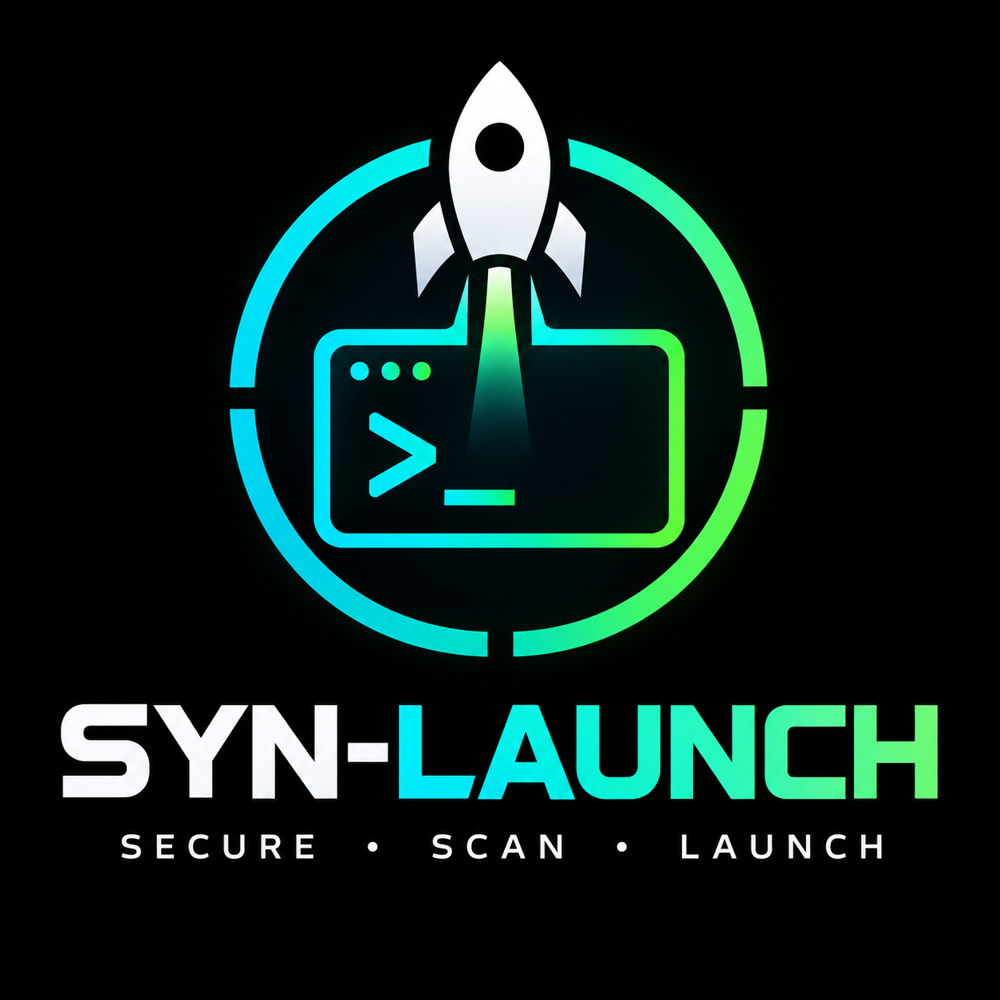

# SYN_LAUNCH

<p align="center">
  
</p>


[](https://termux.dev/)
[](https://www.python.org/)
[](LICENSE)
[](catalog.json)
[](#responsible-use)

**A mobile-first security platform foundation for Termux: searchable tool catalog, installer, and device/runtime diagnostics.**

SYN_LAUNCH groups security and developer tools into numbered menus. Select a tool to see its purpose, installation method, compatibility caveats, upstream source, and example command. Local version/help probes are available only after you explicitly choose Help. The installer can attempt supported Termux packages and opt-in Python, Go, and Cargo installs.

> **Important:** cataloged does not mean installed, compatible, or verified on every phone. Termux is not desktop Linux. Android permissions, kernel features, CPU architecture, package repositories, Python wheels, native libraries, external adapters, and root access all affect compatibility. PATH detection is discovery only. SYN_LAUNCH reports compatibility as unknown/not assessed until there is explicit metadata or evidence, and it does not claim a tool works merely because its executable name appears in PATH.

## Quick start

Install Termux from a maintained source such as [F-Droid](https://f-droid.org/packages/com.termux/) or the [official Termux GitHub](https://github.com/termux/termux-app). Do not mix Termux apps/plugins from incompatible signing sources.

~~~bash
pkg update -y
pkg install -y git python
git clone https://github.com/LILSYNNOFFICIAL/syn_launch.git
cd syn_launch
bash install.sh
~~~

Start the app:

~~~bash
python main.py
~~~

Rich is optional; without it the app uses a plain-text interface.

To collect a private, read-only diagnostic bundle on an Android/Termux device after pulling the latest code, run:

```bash
bash device_check.sh
```

The script runs syntax checks, the unit suite, environment diagnostics, a compatibility report, and a bounded Python help/version probe. It does not install packages, contact targets, or execute the catalog's security tools. It does not mark device validation as passed; inspect the output bundle before sharing it.

## Command-line modes

~~~bash
python main.py --check
python main.py --list
python main.py --search nuclei
python main.py --category "Mobile App Security"
python main.py --tool Nmap
python main.py --compatibility-report > compatibility-report.json
python main.py --smoke-test python
~~~

- `--check` validates the catalog and reports a concise runtime summary.
- `--doctor` reports architecture, Android/Termux signals, process UID, free storage, available runtimes, and catalog install-method counts.
- `--profile` prints a machine-readable JSON runtime profile. Detection signals do not certify individual tools as compatible.
- `--compatibility-report` prints report schema 3 JSON for every catalog entry, separating declared installability, PATH detection, optional compatibility metadata, smoke-test evidence, and device-validation evidence. Missing compatibility metadata is reported as `not_assessed`. The report itself never executes cataloged tools; it incorporates only previously saved smoke-test evidence. Use `--smoke-test NAME_OR_ID` to explicitly run bounded `--version`/`--help` probes for one selected entry. A passing probe confirms only that a help/version response exited successfully, not that tool features work or the device is compatible. Device validation and full functional verification remain separate. A PATH match is discovery only, not proof of installation health or compatibility.
- Bulk installer actions run a preflight that checks free storage, selected package/module counts, and required package-manager/runtime commands before attempting installation. Low or unknown storage and missing runtimes are disclosed; warnings require an explicit `CONTINUE`. This is advisory, does not estimate exact download sizes, and does not verify tool functionality. The latest report is saved privately to `~/.syn_launch/last_preflight.json`. Install summaries also capture the most recent installer subprocess command, label, exit code, timeout/launch failure, timestamps, and bounded-output metadata when a subprocess actually ran. A missing exit code is expected for pre-existing PATH matches or validation failures that never launched a subprocess. Each batch record preserves the requested catalog package and any explicitly pinned Go module version. After each operation attempt, whether it returned success or failure, SYN_LAUNCH queries installed metadata using `dpkg-query` for Termux packages and the isolated environment's Python `importlib.metadata` API for Python packages, emitting only the version string. A resolved version is recorded only when the package manager returns version metadata; query failures, missing packages, and unsupported package managers remain explicit, and this metadata is not a functional test. Go module versions are read from bounded `go version -m` build metadata without launching the tool; Cargo versions come from Cargo's local install metadata, and npm versions come from the installed package's `package.json`. Cargo metadata reads are capped at 2 MiB, npm package metadata at 1 MiB, and the npm global-root query at 4 KiB. Ambiguous Cargo versions are left unresolved. Batch summaries include a bounded metadata-only post-install status that never executes the cataloged tool; `verification` remains `not_run`. The selected-tool menu supports explicitly confirmed updates for Termux packages, isolated Python packages, Go modules, Cargo crates, and global npm packages, plus uninstall for Termux packages, isolated Python packages, Cargo crates, and global npm packages. Go/manual/root uninstall remains unsupported until package ownership can be established safely. Each attempt writes a private JSONL lifecycle audit record with before/after metadata and subprocess evidence. Updates are not automatically reversible, may alter dependencies, and a successful package-manager exit is not a functional test.
- `--list` lists the catalog and current PATH-based status.
- `--search` searches tool names, categories, and descriptions.
- `--category` lists tools from a category.
- `--tool` displays a tool's metadata without executing the local binary. In the interactive menu, choose Help to request bounded help/version probing.

## Documentation and project wiki

- [Project wiki home](wiki/README.md)
- [Installation and first run](wiki/Installation.md)
- [Compatibility and verification model](wiki/Compatibility-and-Verification.md)
- [Catalog and tool lifecycle](wiki/Catalog-and-Tool-Lifecycle.md)
- [Security and responsible use](wiki/Security-and-Responsible-Use.md)
- [Troubleshooting](wiki/Troubleshooting.md)
- [Development and contributing](wiki/Development-and-Contributing.md)
- [Platform roadmap](PLATFORM_ROADMAP.md)
- [Changelog](CHANGELOG.md)

The catalog now includes **88 source-backed compatibility declarations**: 84 Termux recipe-backed entries across 66 distinct recipe/subpackage directories, plus four pinned upstream Python packaging-metadata reviews for pip-audit, yamllint, dirsearch, and Sherlock. Every declaration includes a pinned source revision and snapshot URL. Recipe or packaging metadata is not proof of Android/Termux support, current repository availability, ABI support on a particular phone, successful installation, or runtime functionality. The latest expansion adds source-backed declarations for Nmap, ShellCheck, YARA, radare2, Tesseract OCR, ClamAV, OpenSSH keyscan, MTR, and tcpdump. MTR and tcpdump use pinned recipes from the separate `termux-root-packages` repository, so repository configuration and device privileges need separate verification. The compatibility report keeps those evidence levels separate.

## Personal catalog and favorites

Use **Custom tools / favorites** in the main menu to add a tool entry without editing the project files, browse or remove your custom entries, and favorite frequently used tools. Personal entries are stored separately in `~/.syn_launch/custom_tools.json`; favorites are stored in `~/.syn_launch/favorites.json`. These files are user-local and are not committed to the GitHub repository. Custom entries go through the same ID, HTTPS-source, install-method, and package syntax checks as the built-in catalog. Adding an entry saves metadata only; it does not install the tool. Removing an entry does not uninstall its software.

## What's included

**269 catalog entries across 19 categories.** Coverage includes:

- **Termux Core**
- **Network & DNS**
- **OSINT & Recon**
- **Web App Testing**
- **Audit, SAST & Supply Chain**
- **Forensics & File Analysis**
- **Cryptography & Password Hygiene**
- **Wireless & Android Environment**
- **Cloud, Containers & Misc**
- **Advanced Pentest & Exploit Research**
- **Web & API Assessment**
- **Active Directory & Windows**
- **Mobile App Security**
- **Cloud & Container Security**
- **Network & TLS Assessment**
- **Developer & Supply Chain Security**
- **Forensics & Reverse Engineering**
- **Privacy & Metadata**
- **Password & Authentication Auditing**

Advanced entries include Nuclei, Dalfox, Ghauri, RustScan, Kiterunner, ffuf, Gobuster, Subfinder, dnsx, Katana, Naabu, Uncover, PureDNS, gau, gospider, Hakrawler, Gitleaks, OSV-Scanner, Checkov, Bandit, pip-audit, Syft, Grype, Cosign, Terrascan, Semgrep, Trivy, mitmproxy, SSLyze, testssl.sh, YARA, capa, Apktool, APKiD, JADX, angr, pwndbg, RustHound-CE, Cloudsplaining, kube-linter, Dockle, staticcheck, gowitness, steghide, and Pacu. Some entries are intentionally manual-only where a reliable Termux install path is not established.

Some high-impact or desktop-focused projects such as Metasploit, Responder, Hydra, Hashcat, masscan, JADX, and MobSF are explicitly marked manual-only or compatibility-limited. SYN_LAUNCH does not silently root the phone or claim these work on stock Android.

## Installation behavior

The Installer menu provides:

1. **Termux packages:** attempts each distinct package name in the catalog using `pkg`. Some package names may not exist for your repository or architecture.
2. **One tool:** installs one selected tool using its declared method.
3. **Toolchain prerequisites:** attempts Python, Go, Rust, and Node.js runtime packages where cataloged.
4. **Python/Go/Cargo/npm batch:** opt-in attempt of all declared third-party installs. This can consume substantial bandwidth/storage, compile for a long time, and fail when upstream dependencies are incompatible with Android.
5. **Last install summary:** shows operation outcomes, before/after PATH matches, and explicit unverified status for the last batch.

Each bulk action requires an explicit confirmation. Individual third-party installs require typing `INSTALL`. Manual/root entries do not pretend to install automatically.

| Status | Meaning |
|---|---|
| PATH MATCH (UNVERIFIED) | An executable with the expected name is present in PATH. This is not proof that the intended tool is installed correctly or functions. |
| TERMUX PKG | The installer can attempt the named Termux package. |
| PYTHON/PIP | Installs into an isolated virtual environment under `~/.syn_launch/venv`. |
| GO BUILD | Uses `go install` and places generated binaries in `~/.local/bin`. |
| CARGO BUILD | Uses `cargo install --locked`; native compilation may fail on Android. |
| NPM PACKAGE | Uses the configured npm package name if a catalog entry uses this method. |
| MANUAL | No verified automatic Termux install path is provided. |
| ROOT/HW | Requires root, kernel permissions, special hardware, or another environment constraint. |

The progress bar counts completed operations, not downloaded bytes or verified tools. Batch summaries now retain one result per entry, including whether the operation returned success, whether an executable-name PATH match existed before/after, and `verification: not_run`. A successful package-manager/build command is not a functional self-test. Command output is capped at 10 MiB per subprocess to limit log growth; remaining output is drained without being retained. Output is logged under `~/.syn_launch/logs/`; log files are restricted to the current user where Android filesystem permissions allow it. The app does not store target lists or run scans automatically.

## Security and supply-chain safeguards

- Uses argument arrays rather than shell command strings for package installation.
- Validates package/module syntax inside the catalog itself, not just at install time.
- Removes environment-based package-source overrides before installer subprocesses. Python installs use pip isolated mode and the official PyPI index; Go installs use the official Go proxy/checksum database; npm installs pin the official registry and require TLS verification.
- Duplicate display names are rejected to keep catalog selection unambiguous.
- The bootstrap verifies the official HTTPS Git origin, requires a clean checkout on `main`, disables Git hooks during repository operations, and installs Python dependencies through isolated pip against the official PyPI index.
- Validates upstream links as HTTPS URLs with a hostname and rejects embedded URL credentials.
- Validates executable names, boolean install flags, and metadata lengths before a catalog entry is accepted.
- Browsing a tool no longer executes its local binary. Version/help probing occurs only after the user explicitly chooses Help.
- Caps displayed and logged installer output at 10 MiB, and caps explicit help/version probe output at 64 KiB, while continuing to drain process pipes. This reduces log-flood and memory/disk-exhaustion risk.
- Validates catalog IDs, install methods, HTTPS source links, and package/module syntax before use.
- Uses an isolated Python virtual environment instead of installing Python security packages into Termux's system Python.
- Installs Go binaries into a dedicated user bin directory.
- Applies timeouts to subprocess operations and terminates timed-out process groups where supported.
- Stores install logs and summaries with restrictive file permissions where supported.
- Requires explicit confirmation for third-party package/build installation.
- Does not request root, execute a scan on startup, or automatically act on a discovered target.
- Does not treat a PATH match as proof that a tool works. Local help/version probing is best-effort and bounded by time/output limits.

**Supply-chain note:** Python, Go, Cargo, npm, and Termux package managers execute third-party code or build scripts. Confirm the package name, maintainer, and project source before installing. This repository links upstream projects but does not independently audit every release. For high-assurance use, review and pin versions/commits before installing in a sensitive environment.

## Responsible use

Use reconnaissance, scanners, fuzzers, proxies, password-auditing tools, and exploitation frameworks only on systems, apps, accounts, and networks you own or have explicit written permission to assess. Confirm target scope, rate limits, test windows, and stop conditions. Avoid actions that disrupt services or expose real user data.

Some tools can trigger account lockouts, execute commands on vulnerable systems, change cloud/directory state, or capture sensitive traffic. They are labeled with specific caveats. Protect reports, logs, tokens, hashes, and collected directory data. PhoneInfoga and similar services **do not reveal live GPS location merely from a phone number**.

## Platform roadmap

See [PLATFORM_ROADMAP.md](PLATFORM_ROADMAP.md) for the staged plan covering compatibility metadata, verified tool lifecycle, authorized assessment workflows, and optional Linux environments.

## Physical-device validation snapshot

On 2026-10-17, a temporary checkout of commit `e81f9e58eba5b71e8aa8b18f6b6ac0cdce6a0f5e` was exercised on a physical Android 16 / Termux / ARM64 device using Python 3.14.6. The then-current suite passed 28 tests. The CLI started and exited, the complete catalog rendered, search/category/tool detail paths worked, malformed category/tool inputs failed cleanly, and JSON/shell/Python syntax checks passed. The catalog contained 269 entries in 19 categories; 31 entries matched executable names in PATH.

This is a **baseline device result for that exact commit**, not a claim that every listed tool works and not a validation of later commits. The 31 matches were discovery-only. No security tools were installed or run as part of this smoke test. Re-run the device checks after code changes:

~~~bash
cd ~/syn_launch
git pull --ff-only
python main.py --check
python main.py --doctor
python main.py --profile
python main.py --compatibility-report > compatibility-report.json
python main.py --smoke-test python
python -m unittest discover -s tests -v
~~~

Review the JSON report locally before sharing it because it includes local executable paths and runtime details.

## Development and verification

Run these checks locally:

~~~bash
python -m py_compile main.py
bash -n install.sh
python -m unittest discover -s tests -v
python main.py --check
~~~

GitHub Actions runs Python syntax, bootstrap-shell, JSON, catalog-integrity, CLI, bootstrap-security and regression checks on pushes and pull requests across Python 3.10, 3.12, and 3.14. CI success on Ubuntu does not prove that a package installs or runs on Android/Termux. Real device testing is still required for Termux compatibility.

## Contributing

See [CONTRIBUTING.md](CONTRIBUTING.md) for catalog requirements, package-safety rules, testing, and upstream attribution. Report security issues privately using GitHub's security reporting feature when available; see [SECURITY.md](SECURITY.md).

## Credits and licenses

SYN_LAUNCH is a launcher/catalog, not the author of the listed tools. The catalog links each entry to a project or documentation source where known. Each upstream project retains its own license, trademark, API terms, and attribution requirements. Verify license and distribution conditions before bundling or redistributing any third-party software.

## License

SYN_LAUNCH code is released under the MIT License. Third-party tools retain their own licenses and terms.


## Dry-run assessment workflow plans

SYN_LAUNCH includes scope-bound dry-run plans, three read-only local adapters (device inventory, APK archive inventory, and evidence-report generation), and a deliberately narrow HTTPS adapter that makes one HEAD request. It is not a general-purpose scanner. No adapter grants permission to test an asset.

List plans:

```bash
python main.py --workflow-list
```

Emit a JSON plan only after declaring the target scope and confirming authorization:

```bash
python main.py --workflow-plan web-api-review --target-scope "https://staging.example.test/api" --authorized
python main.py --workflow-plan mobile-app-review --target-scope "owner-provided APK and isolated test device" --authorized
python main.py --workflow-plan device-configuration-audit --target-scope "my own Android device and Termux environment" --authorized
python main.py --workflow-plan assessment-report --target-scope "approved engagement evidence set" --authorized
```

The `--authorized` flag is an operator declaration only. SYN_LAUNCH does not verify legal authority. Plans include explicit scope, stop conditions, and a declaration that no network actions or subprocesses were executed. See [Workflow Planning](wiki/Workflow-Planning.md) for details.

Run the local device inventory (scope must be exactly `local-device`):

```bash
python main.py --workflow-run device-configuration-audit --target-scope local-device --authorized
```

The report also checks for PRoot, PRoot-Distro, and NetHunter command/rootfs markers. These are presence indicators only. It does not enter containers or establish host root or kernel capabilities.

Make one bounded HTTPS HEAD request to an explicitly authorized endpoint. The adapter verifies TLS certificates, has a five-second timeout, does not follow redirects or read the response body, and only retains selected response headers:

```bash
python main.py --workflow-run web-api-review --target-scope "https://staging.example.test/api/health" --authorized
```

Replace the example with an endpoint you are explicitly authorized to test. This command sends a real network request.

Inventory an APK you own or are authorized to review, without extracting or executing it:

```bash
python main.py --workflow-run mobile-app-review --target-scope "$HOME/path/to/your-test.apk" --authorized
```

Summarize a local JSON evidence file containing a `findings` list. Each finding requires `title`, `severity` (`critical`, `high`, `medium`, `low`, `info`, or `unknown`), `asset`, `evidence`, and `remediation` strings:

```bash
python main.py --workflow-run assessment-report --target-scope "$HOME/path/to/evidence.json" --authorized
```

Reports are saved with owner-only permissions under `~/.syn_launch/workflow-runs/`. APK inventory reports include the file hash and archive metadata, not the full local path. The HTTPS adapter performs only a single HEAD request, not a vulnerability scan. The local evidence-report adapter validates structure and summarizes supplied findings; it does not independently verify them.

